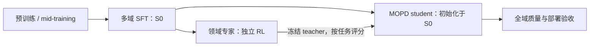

# OPD：训练路线、能力融合与异步实现

资料核对日期：2026-10-24。本文区分公开方法、数学分析和建议实验。同步 OPD 已接入 `idle_rft` 周末实验，teacher 资格、三种子 OPD 和三种子 replay 的完整 GPU 训练及全部 16 个模型盲测已完成；42 个任务均已终止。既有候选筛选与 LoRA SFT 成绩单独报告。上述42个任务为原pilot；独立补强的36组训练及全部评测也已完成，结果和全程资源核算见§7.2。

## 1. OPD 在完整训练流程中的位置

On-Policy Distillation 的关键是 **student 生成轨迹，teacher 在 student 实际访问的前缀上提供分布监督**。OPD 可以直接优化分布距离，也可以把 teacher/student 的 logprob 差作为 policy-gradient 信号。使用 RL 框架执行 OPD，不等于一定使用环境奖励；OPD 也不限于大模型压缩成小模型。GKD、MiMo 和当前框架文档分别提供了这些方法依据。[cite:1](#source-1)[cite:2](#source-2)[cite:8](#source-8)

完整生命周期通常是：预训练 → 可选领域/长上下文 mid-training → 多域 SFT → 能力强化与融合 → 通用行为校准 → 部署验收。缺少领域知识时，先考虑继续预训练、领域 SFT 或检索；不要把 OPD 当作保证补齐全部知识的工具。

| 目标 | 可行顺序 | 核心判断 |
|---|---|---|
| 小 student 吸收现有强 teacher | SFT → OPD → 可选 RL | teacher 已具备能力，先迁移再用任务奖励强化 |
| 多域专家融合 | 多域 SFT → 并行领域 RL 专家 → MOPD | 专家与 student 可同规模，先生产能力再融合 |
| 多域顺序强化 | SFT → 推理 RL → Agent RL → 通用 RL → 跨阶段 OPD | 保存各阶段强 checkpoint，恢复被后续训练削弱的能力 |
| 蒸馏与结果优化同时进行 | SFT → OPD + RL | teacher 提供密集引导，环境奖励决定实际任务成功 |
| teacher/student 迭代提升 | 融合 student → 新一轮专家 RL → 新一轮 MOPD | 每一轮明确 teacher 版本和能力增益，不在轮内任意漂移 |

多域混合 SFT 后再分阶段 RL 完全可行。需要保留阶段 checkpoint、固定全域评测、监测遗忘；是否使用 replay、参考策略约束或最终 OPD，由实际回退决定。不能只查看最后训练的领域。GLM-5 是顺序 RL 后恢复能力的公开例子；MiMo 的领域专家并行训练则提供另一种组织方式。[cite:2](#source-2)[cite:3](#source-3)[cite:4](#source-4)

图中路线对应 MiMo/MOPD 的同源专家融合。它与“一个模型依次经历多个 RL 阶段，再以历史阶段 checkpoint 蒸馏恢复”是不同的依赖关系。

## 2. 初始化、teacher 与可学习性

### 2.1 初始化选择

对于同源专家融合，推荐明确保存共同的多域 SFT checkpoint `S0`：每个领域专家从 `S0` 出发训练；融合 student 同样从 `S0` 初始化。MOPD 方法论文 §3.1 明确采用这个顺序。直接从某个最强领域专家初始化会引入领域偏置，应作为独立消融，不应与默认方案混用。[cite:2](#source-2)

对于已有异源大 teacher 的压缩，student 通常从自身 SFT/Instruct checkpoint 开始。如果 student 连基本答案格式、工具协议或推理风格都不稳定，先做少量适配 SFT，再比较 OPD。直接从纯 base 做 OPD 在算法上可行，但不能跳过可学习性验证。

需要区分三个含义：

- **同源**：来自同一个共同 checkpoint 的不同领域增强版本。
- **同族**：同系列模型，可能规模不同、训练谱系不同；不自动等于同源。
- **异架构或异 tokenizer**：分别影响运行后端与 token 分布对齐，两者不是同一个限制。

teacher 不必更大。与 student 同规模、同词表的领域 RL checkpoint 就可以提供新增行为能力。同族 32B → 8B 是另一类可行用法；参数比没有普适的最佳范围。MoE 还需分别计算总权重规模与激活计算量。[cite:2](#source-2)[cite:7](#source-7)

### 2.2 OPD 前的资格评估

仅有 teacher 在榜单上更强还不够。建议建立以下独立证据：

| 检查 | 具体测量 | 决策意义 |
|---|---|---|
| 任务能力差距 | 同题、同工具、同输出预算下的 teacher/student 成功率、配对胜负、置信区间 | 证明目标领域存在真实可迁移增益 |
| student 状态上的 teacher 能力 | 从 student 的正确和错误前缀续写，检查 teacher 是否能给出有用继续动作或纠错 | 避免 teacher 只擅长自己的轨迹 |
| 分布差距 | student 轨迹上的 token logratio、分布 KL/JS、entropy、top-k overlap 与概率质量 | 区分能力差、格式差与极端惩罚 |
| 初始训练可学性 | 短 OPD pilot 对比不更新控制组、等预算离线蒸馏；检查参数更新及独立 dev | KL 降低不能替代任务提升 |
| 非目标领域保持 | 全域固定回归集、事实性、格式、输出长度 | 防止目标领域提高掩盖其他能力丢失 |

前缀续写评估需要把学生错误、不可修复前缀、环境故障分开标记。teacher 在错误前缀上给某个错误最终答案较高概率，不一定代表监督异常：该答案可能已被前面的错误推导决定。密集 token 信号更常作用在早期分叉点；它不是经过真实验证的 process reward。[cite:9](#source-9)

MOPD §4.4.2 的消融把 Qwen3-30B-A3B 的同源数学专家换成更大的 Qwen3-235B-A22B：初始 token KL 约从 0.04 增至 0.19，数学成绩退化，top-k 版本在该配置下出现训练崩溃。这支持“分布兼容性重要”，**不构成异源 teacher 必然失败的定理，也不能把 0.04/0.19 当通用阈值**。[cite:2](#source-2)

### 2.3 词表与异源 teacher

直接 token KL 需要比较同一事件空间。同词表大小不够，必须核对 token ID → 字节/字符串、added tokens、特殊 token、分词行为、模板、response 边界及 EOS 处理。模型架构可以不同，只要评分后端支持且 token 对齐成立。Miles 和 verl 的现有直接评分接口明确要求 student/teacher 共享 tokenizer/vocab。[cite:7](#source-7)[cite:8](#source-8)

tokenizer 不同时，student 的一个 token 可能对应 teacher 的多个 token，甚至跨越 teacher 的 token 边界。把同一字符串重新分词后逐位置减 logprob，不是合法的同空间 token KL。

可选路线：

1. 用异源 teacher 生成或纠正文本，重新以 student tokenizer 做离线 SFT。
2. 把 teacher 的序列级分数、偏好或可验证结果作为 RL 信号；单独处理长度与分词影响。
3. 使用经过验证的跨 tokenizer 蒸馏或共同字节事件建模；这需要专门的条件概率与对齐方案。
4. 先训练同 tokenizer 的桥接 teacher，再比较直接 OPD。

第一轮项目推荐同源同 tokenizer，异源作为后续独立变量。若固定 teacher、相同上下文下的 student 与 teacher 完全相同，蒸馏信号为零；self-distillation 的新增信号必须来自不同 checkpoint、特权信息或不同推理预算。

## 3. 公开路线与版本区别

| 公开版本 | 训练路线与 teacher 来源 | 蒸馏机制 | 能据此陈述的区别 |
|---|---|---|---|
| MiMo-V2-Flash | 通用 SFT；领域 RL/SFT 专家；MOPD 融合 | reverse-KL token advantage，可叠加 outcome advantage | 专家能力生产和融合解耦；联合 OPD + RL 有明确公式 |
| MOPD 方法论文 | 专家/student 共享同一 SFT 初始化；独立领域 RL | sampled-token PG；修正 teacher top-k divergence | 明确同源消融、两种 loss 和专家融合对照 |
| GLM-4.5 | SFT、reasoning/agent/general RL，expert model iteration | 报告包含迭代蒸馏和 rejection sampling | 不能只凭“self-distillation”就称其为同一 token OPD 算法 |
| GLM-5 | 多域 SFT → reasoning RL → agentic RL → general RL → 跨阶段 OPD | 历史阶段 checkpoint 作 teacher，token logratio 作 advantage | §3.5 明确为最后阶段恢复；不是 MiMo 式所有专家并行生产 |
| DeepSeek-V3.2 | 领域 specialist RL → specialist 生成蒸馏数据 → mixed RL | 蒸馏数据训练后，推理/Agent/对齐合并 RL | §3 没有把这一步表述为 student rollout 上的 token OPD |
| DeepSeek-V4 | specialist SFT/RL → 多专家 OPD | full-vocabulary reverse KL；超过十个 teacher | §5.1 明确以 OPD 替代 V3.2 的 mixed RL 阶段 |

来源分别是公开技术报告，不推断未披露的内部参数或实验。[cite:2](#source-2)[cite:3](#source-3)[cite:4](#source-4)[cite:5](#source-5)[cite:6](#source-6)[cite:10](#source-10)

GLM-5 引言使用“throughout this process”的宽泛表述，但方法 §3.5 原文是“perform on-policy cross-stage distillation as the final stage”。解释准确训练顺序时以方法段为准。其 OPD 阶段 group size 为 1，因为 advantage 直接来自 teacher 差距，不需要组内估计。[cite:4](#source-4)

因此，到核对日期，“按任务路由 teacher”和“RL + OPD”均有公开框架和生产模型先例。它们是成熟的可选路线，但不是所有机构统一采用的标准 recipe；单凭把这些组件组合起来不足以主张算法创新。[cite:1](#source-1)[cite:3](#source-3)[cite:7](#source-7)[cite:8](#source-8)

其他融合路线包括混合 RL、顺序 RL、专家轨迹离线 SFT、权重/任务向量 merge、独立 adapter 或在线专家路由、迭代专家再融合。它们分别交换训练耦合、遗忘、分布偏差、参数冲突和部署复杂度。在线模型路由保留多个模型，不等于形成一个融合 student。

## 4. Loss、top-k 与 sampled token

### 4.1 定义及梯度

设状态 \(s_t=(x,y_{<t})\)，当前 student 分布 \(p_\theta\)，teacher 分布 \(q_d\)。最常见的 reverse KL 为：

\[
D_{\mathrm{RKL}}(p_\theta\Vert q_d\mid s_t)
=\sum_v p_\theta(v\mid s_t)\log\frac{p_\theta(v\mid s_t)}{q_d(v\mid s_t)}.
\]

在固定状态上，用 \(a_t\sim p_\theta\) 可以估计：

\[
A_t^{\mathrm{OPD}}=\operatorname{sg}\!\left[\log q_d(a_t\mid s_t)-\log p_\theta(a_t\mid s_t)\right],
\qquad L_t^{\mathrm{PG}}=-A_t^{\mathrm{OPD}}\log p_\theta(a_t\mid s_t).
\]

这给出固定状态条件 reverse KL 的梯度估计。实际训练一般将采样前缀固定；不能把这种局部 surrogate 的梯度直接称为完整轨迹期望的无偏梯度。完整轨迹目标还涉及状态分布依赖和后续奖励传播。Thinking Machines 的实现明确采用 immediate token signal，discount 为零；这是实际选择，不是唯一推导。[cite:9](#source-9)

实现时 teacher 不反传，advantage detach。直接对固定 token 的 `logp_student - logp_teacher` 反传，teacher 部分是常数，无法得到预期蒸馏梯度。单 token logratio 可以为负；只有期望 KL 非负，不要因为名字里有 KL 就把所有负值裁成零。[cite:8](#source-8)

与 RL 联合时可以采用：

\[
A_t=A_t^{\mathrm{task}}+\lambda_d A_t^{\mathrm{OPD}},
\]

或者将直接分布 loss 与任务 policy loss 相加。两种实现不能只按参数名视为完全等价。还需区分 teacher 吸收能力的约束与 SFT/reference 保持行为的约束；同时使用时会发生竞争。[cite:3](#source-3)[cite:8](#source-8)

RL 和 OPD 的系数建议按领域有效 token 及实际梯度贡献检查，并用 dev 调整。不要把 OPD advantage 再套入默认 GRPO 组内标准化，否则可能改变 dense teacher 信号；尤其纯 OPD 可用 group=1。

### 4.2 三类实现取舍

| 实现 | 获得的监督 | 优势 | 主要限制 |
|---|---|---|---|
| sampled-token PG | teacher 在实际采样 token 上的 logprob | 传输小，容易复用 RL infrastructure | 有采样方差，行为概率与当前分布不一致时需校正 |
| top-k 分布 loss | teacher 或 student 选定 token 的共同概率 | 比单 token 更丰富、传输可控 | support、概率质量和截断修正决定具体目标 |
| full-vocabulary loss | 完整 teacher/student 条件分布 | 固定状态上没有 action Monte Carlo/截断误差 | output head、显存、传输和 TP reduction 代价高 |

top-k 不等于“取 k 个 logits 做 softmax”。logprob 必须保留相对于全词表的归一化常数；单独归一化 top-k 得到的是条件分布，可能抹掉 tail mass 信息。teacher top-k、student top-k、intersection、union 也不是等价的支持集。

MOPD 方法论文的 teacher top-k 目标为：

\[
L_K=\sum_{v\in K}\left[p_v\log\frac{p_v}{q_v}-p_v+q_v\right].
\]

其中 \(-p_v+q_v\) 使被选 token 上的最小值位于 \(p_v=q_v\)；但它仍不等于完整词表 KL，也没有辨识 tail 内部的分布。其同源实验中 k=64 的 top-k 版本与 sampled-token PG 整体相近，并未证明 top-k 始终更优。[cite:2](#source-2)

另一个选择是保留 K 个 token 加一个 tail bucket：

\[
p_{\mathrm{tail}}=1-\sum_{v\in K}p_v,\quad
q_{\mathrm{tail}}=1-\sum_{v\in K}q_v.
\]

在这 K+1 个共同类别上计算 forward/reverse KL，是**粗粒度分布的精确 KL**；由合并类别仍损失 tail 内部信息。当前 verl 提供 `forward_kl_topk_tail`。这与 MOPD 的修正 reverse-KL top-k loss、Miles 的 top-k reward aggregation 是三种不同实现。[cite:7](#source-7)[cite:8](#source-8)

top-k 的第一轮比较应记录 teacher/student 覆盖质量、overlap、tail mass、任务分数、传输字节、teacher prefill 和 learner 耗时。K=16/64/128 仅作为实验选项，不先假定 K 越大越好。student 仍通常需要完整词表的 logsumexp；稀疏传输不自动意味着 output projection 也变成稀疏计算。

DeepSeek-V4 §5.2.2 采用另一条系统路线：缓存 teacher 最后层 hidden states，训练时加载相应 teacher head 重建全词表 logits，按 teacher ID 分组减少 head 切换，异步 offload/load，并用 TileLang kernel 计算精确 KL。它说明“top-k 才能工程化”不是普遍结论。[cite:6](#source-6)

## 5. 异步链路和陈旧数据

### 5.1 三种漂移必须分开

1. **行为轨迹漂移**：rollout 来自旧 student，当前训练模型已改变。
2. **teacher 信号漂移**：teacher checkpoint、模板或评分配置发生变化。
3. **框架/采样漂移**：相同权重下，推理量化、kernel、MoE routing、temperature/top-p 使概率不同。

固定 teacher 的相同序列评分可缓存；student 更新不使 teacher 的条件概率自动过期。但是原序列的前缀分布仍来自旧 student。刷新 student logprob 只能刷新条件 advantage，不能让旧轨迹变成严格 on-policy。Open-MOPD 的 reward refresh 应与轨迹陈旧性分别评估。[cite:11](#source-11)

### 5.2 需要保留的契约

每个样本至少携带：`sample_id`、`domain`、`teacher_id/version`、`student_rollout_version`、逐 token 的行为 logprob、token IDs、response/action mask、模板/tokenizer 哈希、采样配置、生成时间、截断/完成原因、环境成功或故障类型。允许轨迹内更新权重时，还需逐段版本边界。

评分与训练必须按 ID 和 token 位置回配，不依赖异步返回顺序。工具、用户和环境返回的 token 不当作 student 动作计算 policy loss；teacher 仍需看到合法的完整上下文。缓存键必须包含 teacher 版本与输入/模板/评分配置。

### 5.3 校正与接受门禁

记行为策略为 \(\mu\)，当前 student 为 \(p_\theta\)：

\[
\rho_t=\exp\left(\log p_\theta(a_t\mid s_t)-\log\mu(a_t\mid s_t)\right).
\]

实践中可在有限版本差下使用 importance ratio，裁剪或 mask 过度偏离 token，丢弃严重陈旧或环境损坏的样本。**token ratio 校正的是固定旧前缀上的动作分布，不完全校正整个前缀的访问概率**；完整前缀权重连乘通常方差很高。异步方案因此是受控 off-policy 近似，应与同步基线比较。

不要把历史行为 logprob 替换为重算的当前 logprob，否则 ratio 被错误地消成 1。若 PPO 已有 current/old ratio，又引入 train/rollout 校正，需要明确各自分母，避免重复计权。top-p 截断导致行为策略对某些 token 概率为零时，简单 importance sampling 也无法恢复被排除支持集。

GLM-5 §4.1.2 直接使用 rollout logprob 作行为代理、双边 mask 极端 ratio，并按最旧模型版本丢弃陈旧轨迹；报告明确承认受控 off-policy bias。DeepSeek-V3.2 的 off-policy sequence masking 则只针对高偏离且负 advantage 的序列，不能把该规则不加区分地照搬到所有 OPD loss。[cite:4](#source-4)[cite:5](#source-5)

建议顺序：同步正确性 → 只重叠 teacher prefill → 有限 lag rollout → 更深流水线。监控 accepted tokens/GPUh、lag 分布、有效样本率、ratio/ESS、丢弃原因、各域等待时间与任务分数。增加异步深度若只提高 raw tokens/s、同时丢弃大量旧数据，不构成有效吞吐提升。

DeepSeek-V4 还公开了 token WAL 与前缀恢复：被抢占时保留已生成 token，恢复或重新 prefill 继续。只反复重跑长请求并接收幸存短请求，会引入长度相关选择偏差；任何恢复实现还要绑定行为版本、RNG 与已提交状态。[cite:6](#source-6)

## 6. 多域融合、专家差距与回退

按 prompt 的领域路由一个 teacher，可以把不同 RL reward 的标度冲突与融合阶段解耦，但 student 的共享参数、领域 token 预算和输出风格仍会发生干扰。若同一状态同时学习多个 teacher，必须明确“多个 KL 相加”与“teacher 分布先求混合”：

\[
\sum_i w_iD_{\mathrm{RKL}}(p\Vert q_i)
\quad\ne\quad
D_{\mathrm{RKL}}\!\left(p\Vert\sum_i w_iq_i\right).
\]

在固定状态、固定权重且正概率支持上，前者对应归一化几何组合 \(q_*(v)\propto\prod_i q_i(v)^{w_i/\sum_jw_j}\)。若专家冲突，它倾向共同高概率区域，不等于覆盖各家长处的算术混合。第一轮用显式 domain hard routing，保留混合任务评测，便于辨识干扰。

领域采样比例、响应 token 比例和实际梯度贡献不同。长数学/代码轨迹可能挤压短指令任务，单纯按 prompt 1:1 采样不保证训练贡献 1:1。Open-MOPD 分析了 token-share、不同领域收敛速度和陈旧 reward；预算调节应依赖 dev 而不是 blind，避免根据 loss 大小盲目追逐难学或格式不匹配的 teacher。[cite:11](#source-11)

融合验收至少同时报告：

- 各领域 student 相对初始 `S0` 的配对提升。
- 各领域 student 相对对应专家的绝对差距。
- 各领域单独 OPD student 与融合 student 的差距，区分“蒸馏本来学不到”与“融合造成干扰”。
- 宏平均、部署流量加权分数、最差领域与跨域任务表现。
- 多训练种子、配对 CI、相同工具/输出预算及部署成本。

可辅助使用 headroom recovery：

\[
\mathrm{Recovery}_d=\frac{S_d-S_{0,d}}{T_d-S_{0,d}}.
\]

当专家并未优于初始 student、或分母很小时，不使用该比例作稳定结论，改报原始分数与差距；不能将归一化 recovery 当原始 accuracy。

MiMo-V2-Flash Table 7 的实际领域差距：

| benchmark | best teacher | 融合 student | student − teacher |
|---|---:|---:|---:|
| AIME 2025 | 93.9 | 94.1 | +0.2 pp |
| SWE-Bench Verified | 74.2 | 73.4 | −0.8 pp |
| BrowseComp | 51.7 | 45.4 | −6.3 pp |
| Arena-Hard Creative Writing | 90.1 | 86.2 | −3.9 pp |

这是作者报告的特定配置结果，不是本项目结果，也没有据此证明每个差距的统计显著性。它明确说明不能把“融合保留专家峰值”当作所有领域的保证。[cite:3](#source-3)

单域回退有两层：

1. **训练回退**：从共同 checkpoint 重训该域 adapter，或保留专家作为下一轮 teacher；不把最后一个全域 checkpoint 直接覆盖为单域专家。
2. **部署回退**：未达到事先冻结的该域非劣阈值时，按已知任务/可靠分类器路由到单域模型或 adapter。记录 fallback 触发率、该流量质量、延迟与额外模型成本。

推理路由不允许依赖答案正确性 oracle。展示单模型分数和带 fallback 的系统分数时，必须分开。

## 7. 可执行项目范围与实验次序

建议项目题目：**同源专家的多域 OPD 融合与有界异步训练**。可讲的贡献应来自“为何学不动、怎样保持不同领域、怎样在异步下保证概率契约与有效吞吐”，而不是仅实现 teacher 路由参数。

当前已有 Qwen3.5-4B 权重加载、LoRA 更新、checkpoint 恢复和 H20 执行经验，可复用设施。但当前权重的训练谱系还不足以证明它是纯预训练 base；权重 hash 或文本前缀转换都不能证明这一点。如果采用现有公开 Instruct 权重，项目应准确称为“Instruct 起点的 post-training”，不能声称从原始 base 完整训练。严格 base → 部署的实验需先确定真实 base 资产及其来源。

后续扩展方案使用数学与代码两个可验证领域，保留指令跟随作为固定回归域；三域共同 SFT 和第三个专家在前两域闭环后扩展。代码测试应由 CPU/隔离 sandbox 执行，private test/reference 不进入 GPU rollout payload。当前实际实验只覆盖两个代码任务集，代码规格 A/B 选题不等于两个领域专家。

| 阶段 | 产物 | 必要验收 |
|---|---|---|
| 资产与共同初始化 | tokenizer/template/模型来源清单、S0、固定 train/dev/blind | 来源与事件空间一致、划分无泄露 |
| 同源领域专家 | math/code 专家、各域强弱和前缀续写测量 | 专家具备可辨识增益且 student pilot 学得动 |
| 同步 OPD | sampled-token、修正 top-k 或 tail-aware、短 full-vocab 对照 | 概率/位置一致；参数更新；任务分数与回归域验收 |
| 融合比较 | 单域 OPD、离线蒸馏、混合 RL、MOPD | 各域专家差距、融合额外损失、等预算比较 |
| 联合训练 | 纯 MOPD 与 MOPD + outcome RL | 新增环境 reward 是否改善任务或只改变长度 |
| 异步与部署 | teacher prefill overlap、有限 lag、最终模型及回退策略 | 质量非劣、accepted tokens/GPUh、释放与部署回读 |

主比较先固定一个已验证 loss，异步只改变调度；不要把 teacher、loss、domain sampling 和 lag 同时修改。补充消融按重要性顺序做：

1. 同源专家 vs 更强但不同源 teacher；必须保留 tokenizer 兼容性。
2. sampled-token vs top-k/full-vocab；区分估计方差和截断偏差。
3. 纯 OPD vs RL + OPD；匹配 student 更新预算并单列 teacher 评分成本。
4. 同步 vs teacher-only overlap vs 有限 rollout lag。
5. prompt-share vs token-share；静态份额 vs dev gap-aware 分配。

预算比较同时使用两种口径：固定 student 有效训练 token 的科学比较、固定总 GPUh 的系统比较。总成本覆盖专家训练、student rollout、teacher prefill、learner、空等与失败；已有专家的融合边际成本与从零生产专家的完整成本分开报告。

既有周末授权上限是总计 3000 GPUh、高优先并发至多 64 卡；OPD 新任务与仍在执行的实验共用账本，不另起一份 3000 卡时额度。实际执行按下述冻结协议进行，未预填最终成功率、速度或专家保真率。

第一轮可将“每域允许下降幅度”作为部署要求冻结，例如 1 pp 仅是可选工程阈值，不能称行业惯例。使用独立 dev 选配置，最终 blind 一次性验收；如果置信区间太宽则报告证据不足，不用单 seed 的最高分交差。

### 7.1 当前实际接入的实验

复用完成的 MBPP SFT adapter 作 student，同时作 MBPP 保持 teacher；bank teacher 取原实验按全部 18 项开发集选出的公共学习率和胜出组，teacher seed42 在资格验收前固定。二者共享同一 Qwen3.5-4B 权重、tokenizer 与 rank16；这是同规模两任务融合，初始化并非共同多域 SFT `S0`。

完整 bank dev：student 664/768，teacher 760/768，配对 98 胜/2 负，提升 12.50 pp，95% CI [10.16, 14.97] pp。通过预先冻结的 +1 pp 且 CI 下界为正门槛。该结果证明目标任务的 headroom，不替代 student 错误前缀续写或最终迁移收益验证。

三种子 OPD 对比三种子 answer-only SFT replay，每配置严格 16,384 响应 token，bank 12,288、MBPP 4,096；LR 5e-5，四响应累积，token-based LR decay。OPD 使用新鲜 student 采样前缀和 teacher top64 修正 reverse divergence，概率保留完整词表归一化，teacher 独立冻结。训练验收检查精确配额、有限梯度、参数哈希变化、Adam 状态和完整 checkpoint 文件哈希。

六组训练均完成上述验收。OPD 三种子进程合计 0.8213 H20 卡时，replay 为 0.1515 卡时，约 5.42 倍；进程计时包括加载、rollout、teacher 评分、更新和保存。平均响应 token/s 分别 16.64 和 90.38，峰值显存分别 17.12 和 13.03 GiB。teacher top64 在本次访问前缀上的 token 加权概率质量为 99.9985%–99.9988%；高覆盖不证明 tail 对梯度无影响。61/402 次 OPD 采样达到 256-token 前缀上限，不能称作完成的正确程序。不同更新访问不同前缀，首末 loss 下降不能当固定评测集收敛。等响应 token 不等计算预算，teacher prefill 的阶段耗时没有单独测量。

全部六个配置统一盲测 1,280 bank 与 170 MBPP 题，包含 warm student 与 bank expert 对照。报告跨 seed 均值/标准差、配对 CI、专家差距和 MBPP 回退。未执行异步 rollout、sampled-token PG、RL reward、异源 tokenizer 对齐或全词表 KL 消融；GPU 冷进程 OPD 恢复没有独立验收；本轮不据此声称恢复能力已在 OPD 上完成验证。

最终盲测每模型 bank 1,280 题、MBPP 170 题：

| 任务 | warm | 任务专家 | OPD 三种子均值 ± std | replay 三种子均值 ± std |
|---|---:|---:|---:|---:|
| bank | 85.39% | 98.59% | 94.66% ± 2.58 pp | 90.13% ± 2.50 pp |
| mbpp | 61.76% | 61.76% | 61.37% ± 0.90 pp | 58.82% ± 0.59 pp |

bank 上 OPD 相对 warm 均值 +9.27 pp，相对 replay +4.53 pp；距 bank expert 仍有 3.93 pp。三个同训练 seed 的 OPD/replay 配对 CI 中两组完全为正、一组包含零；这是逐 seed 的题目配对证据，不能当跨训练种子的总体显著性检验。OPD 三个种子均高于 warm，种子标准差为 2.58 pp，不能只报告最高种子 97.19%。

MBPP 上 OPD 相对 warm 均值 −0.39 pp，replay 为 −2.94 pp；OPD/replay 均值差 +2.55 pp，但三组配对 CI 均包含零。OPD/warm 的三组 CI 也包含零，区间下界最低约 −4.52 pp：没有显著下降不证明非劣，不能据此称为部署保持性验收通过。本轮未冻结并验收部署非劣阈值，也没有执行线上 fallback。

没有单任务 OPD 消融，所以专家差距无法分解为蒸馏迁移缺口与混合训练干扰。teacher 的 100 万监督 token 与融合的 1.6384 万响应 token 也不是等预算；本轮没有按 blind 追加训练。OPD/replay 同时改变轨迹和监督形式，收益不能单独归因于 on-policy。

42 个完整 Pod 区间共 172.98 H20 卡时，观测并发峰值 64 卡，保守预留 721.00 卡时，当前活跃 GPU 为 0；未核验平台账单。完整结果与逐 seed CI 见 `results/FINAL_REPORT.md` 和 `results/opd-final.md`。

代码：[main 分支](https://github.com/Cheongroach/idle-rft-opd/tree/main)。协议、日志与实测：[research 分支](https://github.com/Cheongroach/idle-rft-opd/tree/research)。

### 7.2 用户要求补强后的独立扩展（已完成）

首轮16,384响应token作为pilot保留。独立扩展已完成36组训练、38个完整开发集模型、20个新留出模型与38个固定前缀诊断。开发集按冻结规则选择524,288响应token；保持性开发集选型门槛：True。

训练包括65,536/262,144/524,288响应token的OPD/replay三种子、匹配bank token的单任务OPD、1:1保持份额及512-token前缀消融。各预算的LR horizon不同，不能拼成同一优化轨迹。

新增256道bank dev和2,048道bank最终规格，排除旧8,192道规格hash。新增80道MBPP dev、436道MBPP最终题，排除所有旧427个项目任务ID、规范化题面与alpha-renamed程序；连接重复组不跨dev/final。参考执行516/519通过，排除3道当前协议未通过项；开发集与原开发集合并后共1,154题（bank 1,024、MBPP 130），新留出共2,484题（bank 2,048、MBPP 436）。公开MBPP预训练污染与源测试稀疏的边界仍存在。

| 新留出方法 | bank mean ± seed std | retention mean ± seed std |
|---|---:|---:|
| opd | 98.44% ± 0.13pp | 46.64% ± 0.35pp |
| replay | 96.91% ± 0.24pp | 45.18% ± 0.23pp |
| bank-only | 98.45% ± 0.07pp | 46.02% ± 0.48pp |
| balanced | 98.16% ± 0.15pp | 46.41% ± 0.35pp |
| bank-only-balanced | 98.34% ± 0.10pp | 46.02% ± 0.13pp |
| long-prefix | 96.88% ± 0.70pp | 46.56% ± 0.61pp |

warm：bank 1792/2048，retention 202/436；bank expert 2019/2048。

选定OPD相对warm的bank均值变化 +10.94pp，相对replay +1.53pp；距bank专家 0.15pp。

最大两档OPD预算的bank dev均值变化 +0.13pp；冻结的近似平台期判据：True。该判据只覆盖bank dev，不能证明全域收敛；不同更新访问的前缀不同，训练loss不能替代固定评测。

保持性要求每个种子相对warm的配对95% CI下界≥−2pp。选定OPD全部种子通过：True。区间包含零不等于非劣通过，种子标准差也不是置信区间。

- opd-524288-s42 retention vs warm +0.00pp，95% CI [-1.37,+1.37]pp。
- opd-524288-s43 retention vs warm +0.23pp，95% CI [-1.58,+2.05]pp。
- opd-524288-s44 retention vs warm +0.69pp，95% CI [-0.46,+1.85]pp。

同bank token的mixed/single、平衡份额/single逐seed配对比较、所有模型失败与截断计数、OPD/replay逐seed区间见`extension/final-analysis.json`。固定64个bank和16个MBPP生成前缀只用于无更新条件分布诊断；没有测量teacher纠错续写。

附加数值诊断确认PEFT 0.18.1加载第二个MBPP保持teacher adapter时发生BF16舍入，源checkpoint hash相同不代表运行时权重逐元素相同。全部LoRA参数与warm权重的BF16舍入值一致；临时teacher回填源FP32权重后，一个236-token前缀的输出差异和距离均为0。官方36组实验保留冻结加载方式，MBPP warm非零分布距离包含该精度基线；详见`extension/teacher-load-precision-audit.json`。该探针使用已有Pod中的完成进程空闲GPU，计入原Pod成本，未保存adapter。

补强中三项任务被平台低GPU/SM利用率查杀，并非用户关闭或12小时超时。保全214个文件，仅恢复未完成的10个配置；模型、Adam、调度器、路由游标与Python/Torch/CUDA RNG使用原冻结实现恢复。按实测速率缩短后续任务窗口，正常保存完整优化器和RNG后分段续训，已完成进程不再申请GPU。另一次控制端45秒状态查询超时使协调进程退出；已启动任务仍在各自90分钟窗口保存退出。重新核验6个checkpoint后续跑剩余45,917响应token；只读查询增加有界重试，保存和导出由任务自身窗口负责。详见controller-timeout-recovery.json。原中断Pod及所有续训Pod均计入全程成本。原进程没有正常退出记录时，其进程时间以session开始至Pod停止、且不超过原预留给出上界；逐配置上界标识见update-metrics.json，不把该上界当成精确进程耗时。

选定预算的三种子OPD进程合计 22.74 H20卡时，replay 3.19，比值 7.13x。包含加载、rollout、teacher评分、更新和保存，teacher评分未独立计时。

原实验与补强的完整Pod资源时间共 521.34 H20卡时，保守预留 1853.10/3000卡时，终态活跃GPU为0。Pod时间包括空等，不是平台账单或GPU利用率。

未执行奖励RL、异步rollout、异源词表、完整词表loss消融、线上部署或fallback验收。结果仅支持同规模、同tokenizer的两个代码任务集后训练；主分支提供可移植训练代码，research保留协议、手稿和实测证据。

## 8. 代码阅读入口与面试表达边界

当前工作区包含可阅读的 Miles/verl 源码快照。它们不是独立 Git checkout：在这些目录执行 `git rev-parse HEAD` 会回溯到外层 vllm-omni 仓库。外层提交号不能当作这两份框架的 upstream revision。实跑前应取得真正 upstream commit、固定依赖和源码 hash。

| 阅读入口 | 关注内容 |
|---|---|
| `training_infra_lab/research/posttraining_20261022/upstream/miles/miles/rollout/on_policy_distillation.py` | teacher URL 路由、response 对齐、sampled/top-k 查询与缺失概率处理 |
| 同目录下 `miles/backends/training_utils/loss/hub/opd.py` | teacher 信号 detach，OPD penalty 与已有 task advantage 合并 |
| `verifiable_rl/upstream/verl/verl/trainer/distillation/losses.py` | 直接分布 loss 与 policy-gradient 分支、task reward 的组合 |
| 同目录下 `verl/trainer/distillation/fsdp/losses.py` | 全词表归一化、top-k gather、tail-aware KL |
| 同目录下 `verl/trainer/distillation/tail_kl.py` | tail mass、零概率边界与梯度 |

公开 Miles 文档和 verl 文档分别核实了这些方法与配置类别；源码快照的阅读不等于已经完成 Qwen3.5、长上下文、异步或多 teacher 的 GPU 验收。[cite:7](#source-7)[cite:8](#source-8)

面对基座研究者，项目叙述可按以下证据链组织：

> 从共同 SFT checkpoint 生产同源专家，先验证 task headroom 和学生状态上的 teacher 可学习性；在固定 token 契约上比较 sampled/top-k 信号，分开测量单域迁移缺口与融合缺口；再通过有界异步、概率版本记录和 stale admission 控制提升有效吞吐；最后报告各域专家差距、质量置信区间和部署回退成本。

共同多域 SFT、RL 专家生产和异步链路仍是后续路线。本项目已完成的证据可表述为：

> 负责将同步OPD接入可验证代码后训练，并完成36组预算、单域/混合及保持份额消融；实现完整词表归一化的teacher top64 loss、冻结teacher路由、精确token配额与checkpoint验收。按38个完整开发集模型选定524,288响应token，在20个新留出模型上复核：OPD的bank三种子均值98.44%，较warm变化+10.94pp，较replay变化+1.53pp，距领域专家0.15pp；MBPP保持性均值变化+0.31pp，每种子配对95% CI下界≥−2pp的门槛通过。固定前缀诊断与参数逐元素比较定位了第二个teacher adapter的BF16舍入边界。原pilot及补强完整Pod资源时间共521.34 H20卡时；训练完成、条件分布接近及全域收敛分别报告。

实现依赖 PyTorch、Transformers 和 PEFT；没有使用 Miles/verl 执行本轮 OPD，也没有把多域 RL、异步吞吐或纯 base 到部署记成本次完成工作。

需要能回答的追问：

- 为什么从 S0 初始化，而不是最强专家或最后一个 RL checkpoint？
- teacher 更强为何不一定更好？如何将风格差与能力差分开？
- sampled token 的估计何时无偏？旧 prefix 分布如何处理？
- top-k support 来自谁？是否保留全词表归一化和 tail mass？
- 更新 student logprob 是否让旧 rollout 变为 on-policy？
- prompt 混合比例为何不能代表 token/梯度比例？
- 融合模型距单域专家的差距，是容量限制还是融合干扰？
- teacher prefill 被时延隐藏时，是否仍计算其 GPU 成本？
- fallback 使用什么信号，单模型指标与系统指标是否分开？
- 现有 SFT/RFT 成绩为何不能记成 OPD 效果？

## 9. 来源

[cite:1] Google DeepMind / ICLR 2024，*On-Policy Distillation of Language Models: Learning from Self-Generated Mistakes*。GKD、student-generated 状态、可与 RL 联合。
https://deepmind.google/research/publications/on-policy-distillation-of-language-models-learning-from-self-generated-mistakes/

[cite:2] *MOPD: Multi-Teacher On-Policy Distillation for Capability Integration in LLM Post-Training*，arXiv:2606.30406，2026-06-29。重点 §3.1、§3.2、§4.4；同源初始化、修正 top-k、外部 teacher 消融。
https://arxiv.org/html/2606.30406
https://mimo.xiaomi.com/papers/mopd.pdf

[cite:3] *MiMo-V2-Flash Technical Report*，arXiv:2601.02780v1，2026-01-06。重点 §4.1、§4.4、Table 7；MOPD + ORM 与逐领域专家差距。
https://arxiv.org/html/2601.02780v1

[cite:4] *GLM-5: from Vibe Coding to Agentic Engineering*，arXiv:2602.15763v1。重点 §3.5、§4.1.2；最终跨阶段 OPD 和异步校正。
https://arxiv.org/html/2602.15763v1

[cite:5] *DeepSeek-V3.2: Pushing the Frontier of Open Large Language Models*，arXiv:2512.02556v1。重点 §3、§3.1；specialist 数据蒸馏、mixed RL、off-policy masking。
https://arxiv.org/html/2512.02556v1

[cite:6] *DeepSeek-V4: Towards Highly Efficient Million-Token Context Intelligence*，arXiv:2606.19348。重点 §5.1.2、§5.2.2、§5.2.3；full-vocabulary OPD、teacher hidden-state/head 调度、可恢复 rollout。
https://arxiv.org/html/2606.19348

[cite:7] Miles 官方 OPD 文档。框架支持、同 tokenizer 限制、sampled-token 与 Rethinking top-k reward。
https://miles.radixark.com/docs/advanced/on-policy-distillation

[cite:8] verl 官方 OPD 文档。GKD/PG 分支、multi-teacher、task reward、tail-aware KL 配置。
https://verl.readthedocs.io/en/latest/algo/opd.html

[cite:9] Thinking Machines，Kevin Lu，*On-Policy Distillation*，2025-10-27。sampled-token PG、immediate signal、错误前缀与 teacher 评分。
https://thinkingmachines.ai/blog/on-policy-distillation/

[cite:10] *GLM-4.5: Agentic, Reasoning, and Coding (ARC) Foundation Models*，arXiv:2508.06471v1。expert model iteration、迭代 self-distillation 与多阶段 RL。
https://arxiv.org/html/2508.06471v1

[cite:11] *Open-MOPD: Diagnosing and Fixing Capability Imbalance in Multi-Teacher On-Policy Distillation*，arXiv:2608.19098。token-share、gap-aware allocation 与 student reward refresh；其性能数字未当成本项目效果。
https://arxiv.org/html/2608.19098
