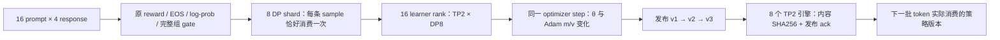

# 32 卡参数与策略版本审计

本实验把“optimizer 返回成功”拆成可独立复算的证据：16 个 learner rank 的模型与 Adam 状态、8 个 DP 数据分片、8 个 TP2 推理引擎，以及每条生成 token 的策略版本。运行结论以对应 `runs/*/verified.json` 和 `training-audit.json` 为准；配置文件不证明训练发生。



## 先定义比较对象

每条记录的身份至少是 `(run, rollout_id, step_id, component, rank, parameter)`。第 `r` 批必须由版本 `r` 生成，训练后发布 `r+1`；初始化发布为 `v0`。同一参数在 TP0 和 TP1 上是不同切片，不能直接比较其 hash。DP 一致性应固定 TP rank 后比较八份模型副本。

Adam 状态可能由 distributed optimizer 分片。检查每个 rank 实际拥有的 `exp_avg` / `exp_avg_sq` 是否存在、有限且变化；不要要求不同 DP rank 的 optimizer 字典逐字相同。标量 `step` 递增只能证明计数变化，不能代替 m/v 变化。

## 诊断顺序与判据

| 观察 | 下一步 | 可排除或定位的问题 |
|---|---|---|
| reward 全相同、未 mask 的 advantage 全零 | 回看候选完整组、原始评分和解析失败 | 无学习信号；优先检查数据与 reward |
| grad 为零，但参数变化 | 联查旧 Adam m/v、weight decay 和真实 LR | momentum/decay 可以更新参数；不等于本批有有效信号 |
| grad 非零、参数与 Adam m/v 都未变 | 检查 LR=0、AMP skip、optimizer outcome、冻结参数 | optimizer 未完成实际更新或更新被跳过 |
| Adam m/v 变化，BF16 参数 hash 不变 | 检查 FP32 master weight 的增量与 BF16 舍入 | 小更新可能暂时未反映到低精度权重 |
| 同 TP 的 DP 模型 hash 不一致 | 对齐同一个成功 step；查 all-reduce 与参数同步 | 副本分叉，不能用 rank0 的成功代表全体 |
| learner 已更新，engine hash 不变 | 对齐 debug update ID、版本、引擎 ack 和发送 payload | 更新没有完整发布 |
| engine 内容一致，样本 span 仍消费旧版本 | 查暂停/恢复、路由、token 绝对区间和版本覆盖 | 发布完成与下一批消费版本之间存在断链 |

参数尺度探针可补充：

`relative_update = ||θ_after − θ_before||₂ / max(||θ_before||₂, 1e-12)`

`RMS(x) = sqrt(sum(x²) / numel(x))`

统计跨 TP 分片的全参数范数时，应归约 `sum(x²)` 和元素数；不要把各分片范数取平均。DP 副本只能取一份或去重，不能把八份副本当八倍参数。阈值应来自同一参数、dtype、LR 与优化器配置下的健康分布。没有适用于所有模型的统一 `relative_update` 健康阈值。

本轮 GPU hook 记录全量 SHA256、实际 topology 和原有梯度指标；它没有接入 `grpo_observability.ParameterTracker` 的范数探针。SHA256 能证明内容变化与相等，不能度量变化大小或证明质量提升。

## 从仓库证据动手

在仓库根目录运行，替换成实际已采集的 run：

```bash
python training_infra_lab/posttraining_runtime/scale32/audit_train32.py \
  --results training_infra_lab/posttraining_runtime/scale32/runs/train-05/shared-results \
  --code training_infra_lab/posttraining_runtime/scale32/runs/train-05/node-0/code \
  --source-manifest training_infra_lab/posttraining_runtime/scale32/runs/train-05/source-manifest.json \
  --output /tmp/train32-recomputed.json
```

本次成功诊断是 train-05；三次真实更新、全部 rank/engine 内容与最终 v3 消费通过。实测 loss 接近零但梯度非零的案例与答案见 [WORKED_EXAMPLE.md](WORKED_EXAMPLE.md)。

先验证源码 hash，再导入归档评分器。审计器依赖 PyTorch，归档 `.pt` 是本实验自有对象，含完整样本结构。

练习一：从 `rollout-0.pt` 找一个解析失败但已保留的负样本，对照 `qualification/candidate-0-*.json`、原评分器与训练分片。解释为什么“过滤掉所有负样本”会改变 GRPO 组内信号。

练习二：用 `pre-update-0-*-rank-*.json` 的 `parallel` 字段重建 `(dp_rank, tp_rank, arnold_id)`，核验 16 个组合完整，并固定 TP rank 比较模型 hash。不要从 Pod 日志下载标签推断物理 rank。

练习三：在相同 `rollout_id` 的事件中串起 learner checksum、`train_group_step_end`、`weight_update_result` 与 `inference_engine_weight_checksum`；最后检查下一批 `weight_versions.spans` 的每个 token 区间是否完整覆盖。

练习四：对照已有 CPU 场景 `zero_lr`、`stale_actor` 与 `healthy`，先写出预期的 grad / 参数增量 / m/v / 版本组合，再导入 `site/parameter-tracking.html` 查看答案。CPU 故障演示与真实 GPU 审计各自保留证据边界。

## 性能对照怎么读

发布实验固定第三次更新后的模型与 optimizer，在同一连接和同一八个引擎上比较 `broadcast` / `broadcast_packed` 与全量 checksum 开关。先验两组发送名字、dtype、shape、字节和 bucket 顺序相同，再看全 rank 墙钟最大值。checksum-off 的补充正确性工作必须位于计时区间之外。

`speedup = median(T_broadcast) / median(T_packed)` 只表示本次权重发布阶段的比值。必须同时报告四次样本、最小/最大值和 checksum 配置；不能据此推导训练 tokens/s、收敛速度或 SOTA 结果。端到端收益还需计入 rollout、训练、暂停、准备和重算的实际暴露时间。
