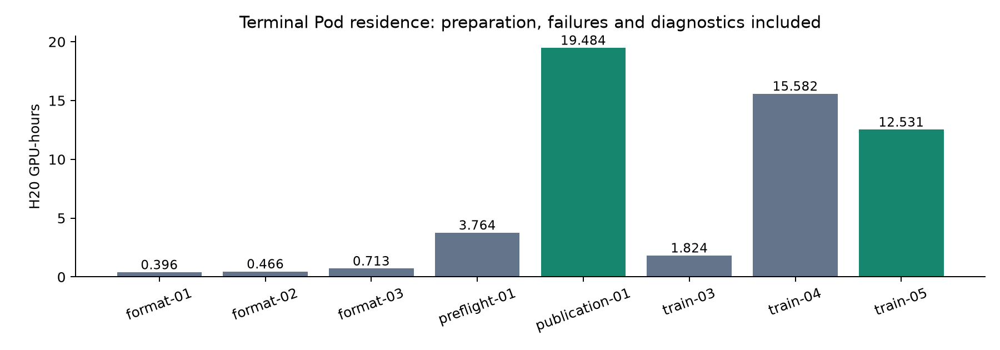
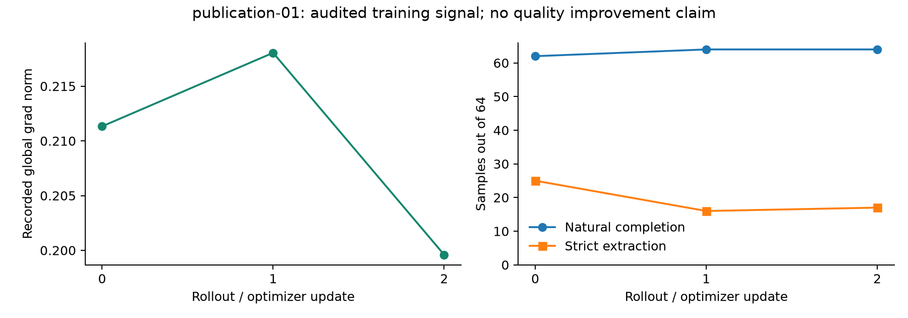
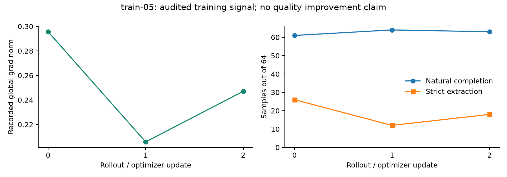
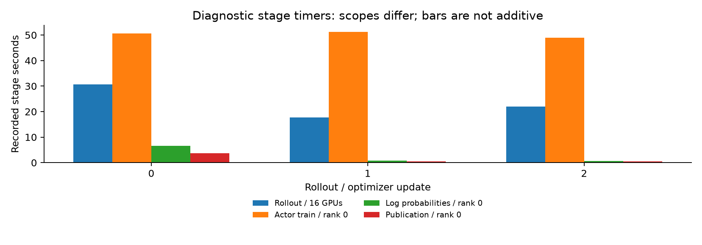
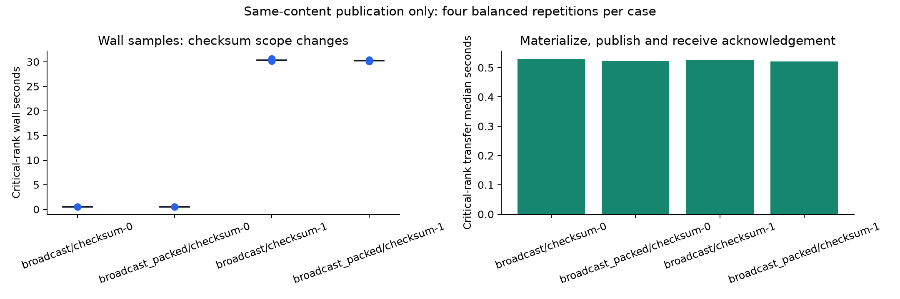
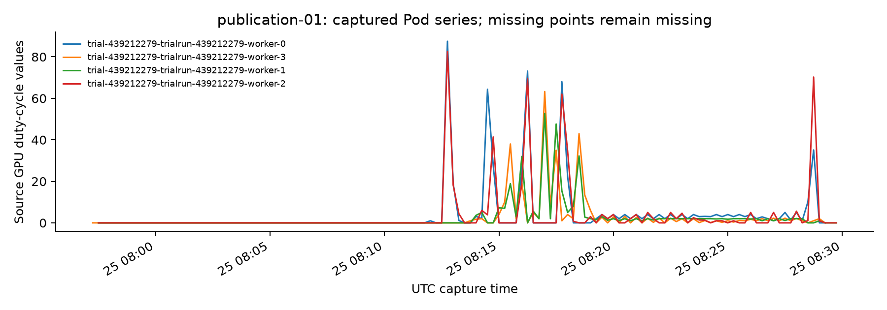
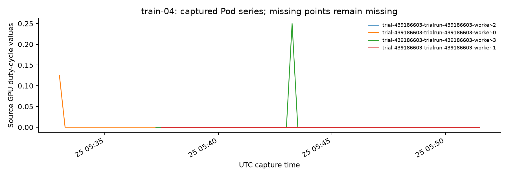
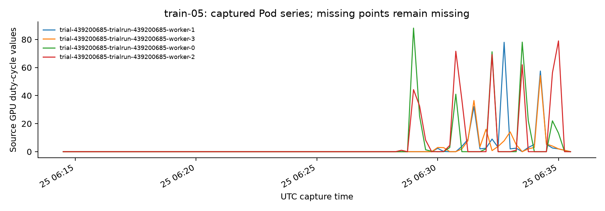

# 32 卡 GRPO 实测与证据

采集时间：2026-10-25T08:39:42.066759+00:00。所有成本从终态 Pod 驻留计算，包含准备、失败和重算；运行中的任务尚未计入。

配置：4 worker × 8 H20；每 worker 64 CPU / 256 GiB。Qwen3-8B；16 learner，TP2 × DP8、PP1、CP1；16 rollout，8 个 TP2 引擎。Miles commit `2233d795dcf167be489d1859971c9233393f04c3`。模型使用逐文件 immutable revision 与 SHA256，未验证 HF commit 一致性。

| 任务 | 状态 | 真实优化边界 | 独立训练验收 | H20·h |
|---|---|---:|---|---:|
| [format-01](runs/format-01/status.json) | failed | 0 | 未通过/待验收 | 0.3956 |
| [format-02](runs/format-02/status.json) | failed | 0 | 未通过/待验收 | 0.4656 |
| [format-03](runs/format-03/status.json) | done | 0 | 未通过/待验收 | 0.7133 |
| [preflight-01](runs/preflight-01/status.json) | done | 0 | 未通过/待验收 | 3.7644 |
| [publication-01](runs/publication-01/status.json) | done | 3 | 通过 | 19.4844 |
| [train-03](runs/train-03/status.json) | failed | 0 | 未通过/待验收 | 1.8244 |
| [train-04](runs/train-04/status.json) | failed | 0 | 未通过/待验收 | 15.5822 |
| [train-05](runs/train-05/status.json) | done | 3 | 通过 | 12.5311 |

已终态扩展任务合计 **54.7611 H20·h**。

## 参数与发布验收

训练通过要求：完整组与奖励变化、每条样本恰好消费一次、有限行为概率、16 learner rank 参数/Adam m/v 的实际变化、同 TP 分片的八份 DP 模型副本一致、八个 TP2 引擎内容一致、v0→v3 发布和最终生成 token 消费 v3。末次评估使用已暴露题目，仅证明协议；不用于能力收益或 SOTA。

### publication-01

| 更新 | 样本 | 自然完成 | 严格格式 | 奖励不同组 | 非零 advantage token | grad norm |
|---|---:|---:|---:|---:|---:|---|
| 0 | 64 | 62 | 25 | 3 | 19453 | [0.2113305777311325] |
| 1 | 64 | 64 | 16 | 4 | 18600 | [0.21805059909820557] |
| 2 | 64 | 64 | 17 | 7 | 39114 | [0.19959458708763123] |

末次暴露题评估：`{"samples": 16, "completed": 12, "strict_extracted": 4, "original_scorer_correct": 0, "response_tokens": 34259, "consumed_weight_version": 3, "scope": "Exposed prompts; protocol only", "quality_improvement_claim": false}`。

### train-05

| 更新 | 样本 | 自然完成 | 严格格式 | 奖励不同组 | 非零 advantage token | grad norm |
|---|---:|---:|---:|---:|---:|---|
| 0 | 64 | 61 | 26 | 7 | 36008 | [0.2956434190273285] |
| 1 | 64 | 64 | 12 | 5 | 25736 | [0.20580638945102692] |
| 2 | 64 | 63 | 18 | 8 | 44074 | [0.24710068106651306] |

末次暴露题评估：`{"samples": 16, "completed": 10, "strict_extracted": 4, "original_scorer_correct": 2, "response_tokens": 38348, "consumed_weight_version": 3, "scope": "Exposed prompts; protocol only", "quality_improvement_claim": false}`。

## 阶段计时与全部卡时的差别

以下 learner 时间来自已锁定的 actor rank 0 指标，不代表全 rank 最大墙钟；不同阶段的计时区间不得随意相加。吞吐分母必须与实际工作量和设备范围对应。

### train-05

| 更新 | response token | 非零 advantage 比例 | rollout（s） | actor rank0（s） | log-prob rank0（s） | 发布 rank0（s） |
|---|---:|---:|---:|---:|---:|---:|
| 0 | 94437 | 38.13% | 30.723 | 50.692 | 6.639 | 3.709 |
| 1 | 93074 | 27.65% | 17.655 | 51.211 | 0.868 | 0.543 |
| 2 | 84743 | 52.01% | 21.988 | 48.917 | 0.630 | 0.547 |

三轮合计 272,254 个训练回答 token，其中 38.87% 为非零 advantage token。该比例表示学习信号覆盖，不能当作正确率。

rollout 阶段：241.819 response token / rollout GPU·s；分母是 16 个 rollout GPU 的生成计时。全部驻留成本：6.035 训练回答 token / 全部 GPU·s；分母包含 32 卡准备、训练、发布及末次评估。两者不是同一个吞吐指标，不能互相替代。

复算入口：`python3 derive_stage_baseline.py --folder runs/train-05`；[原始复算结果](runs/train-05/stage-baseline.json)。

## 等内容权重发布 A/B

固定第三次真实更新后的权重；两次 warmup，普通/packed broadcast × 全量 checksum 开关，各四次平衡顺序测量。每轮核验发送名字/dtype/shape/bytes/bucket 顺序、模型、Adam 与八引擎内容。checksum-off 的内容检查在计时外。

### publication-01

| 方式 | 全部墙钟样本（s） | 墙钟中位数（s） | min/max（s） | 传输中位数（s） |
|---|---|---:|---|---:|
| broadcast/checksum-0 | [0.5243341901805252, 0.537933929823339, 0.5363942375406623, 0.5247604299802333] | 0.530577 | 0.524334/0.537934 | 0.529961 |
| broadcast_packed/checksum-0 | [0.5284532958175987, 0.5168372066691518, 0.538482187082991, 0.5160109288990498] | 0.522645 | 0.516011/0.538482 | 0.521996 |
| broadcast/checksum-1 | [30.111983550013974, 30.28688862454146, 30.670850487891585, 30.278191960882396] | 30.282540 | 30.111984/30.670850 | 0.524696 |
| broadcast_packed/checksum-1 | [30.09110548067838, 30.162988710217178, 30.361172962002456, 30.37483316496946] | 30.262081 | 30.091105/30.374833 | 0.521636 |

发布阶段比值：`{"packed_speedup_checksum_0": 1.0151768001301114, "packed_speedup_checksum_1": 1.0006760756708342}`。该比值不代表端到端训练加速。

相同发送布局共 16,381,470,720 bytes；每轮最大值来自全部 16 learner rank。传输区间包括上游 update_weights 的物化、通信和接收确认；不是链路带宽测量。全量 checksum-on 额外包含 learner 模型/Adam 和八引擎 TP 分片内容 SHA256，以及完成屏障。

checksum 开关的墙钟中位数差（s）：`{"broadcast": 29.75196295895148, "broadcast_packed": 29.739435584866442}`。checksum-off 每轮仍在计时外完成相同内容核验，因此它不是完全不做审计的训练。

## 本轮资源时序

只展示 API 返回的实际点，保留 Pod tags、查询窗口和响应 SHA256。不同看板的面板编号含义不同，以本次 describe 结果为准；空数据不能当作零利用率。

### publication-01

| 面板 | 可读 series | 实际点数 | 逐点来源 |
|---|---:|---:|---|
| 112 | 8 | 1034 | [JSON](runs/publication-01/grafana/panel-112.summary.json) |
| 119 | 20 | 1310 | [JSON](runs/publication-01/grafana/panel-119.summary.json) |
| 7 | 4 | 517 | [JSON](runs/publication-01/grafana/panel-7.summary.json) |
| 90 | 8 | 524 | [JSON](runs/publication-01/grafana/panel-90.summary.json) |

### train-04

| 面板 | 可读 series | 实际点数 | 逐点来源 |
|---|---:|---:|---|
| 112 | 8 | 496 | [JSON](runs/train-04/grafana/panel-112.summary.json) |
| 119 | 20 | 610 | [JSON](runs/train-04/grafana/panel-119.summary.json) |
| 7 | 4 | 247 | [JSON](runs/train-04/grafana/panel-7.summary.json) |
| 90 | 8 | 244 | [JSON](runs/train-04/grafana/panel-90.summary.json) |

### train-05

| 面板 | 可读 series | 实际点数 | 逐点来源 |
|---|---:|---:|---|
| 112 | 8 | 680 | [JSON](runs/train-05/grafana/panel-112.summary.json) |
| 119 | 20 | 855 | [JSON](runs/train-05/grafana/panel-119.summary.json) |
| 7 | 4 | 340 | [JSON](runs/train-05/grafana/panel-7.summary.json) |
| 90 | 8 | 342 | [JSON](runs/train-05/grafana/panel-90.summary.json) |

## 失败记录与学习入口

train-03 的 Ray worker 端口与平台 GCS 重叠；train-04 的严格格式门禁误处理 decoded EOS，四批共 256 条回答未进入 optimizer。修复保留全部原始回答、token 和 reward，将格式统计与训练准入分开；格式失败负奖励仍参与完整组训练。

[参数判断与四道练习](PARAMETER_AUDIT.md) · [实测案例与答案](WORKED_EXAMPLE.md) · [执行规格](SCALE32_PLAN.md) · [机读复算结果](results-summary.json)。新增 Grafana 资源时序按实际 Pod tags 展示；历史 NSYS 和逐卡图仍属原四卡采集。本轮没有节点丢失恢复、RDMA 带宽或独立 held-out 质量实验的结论。
