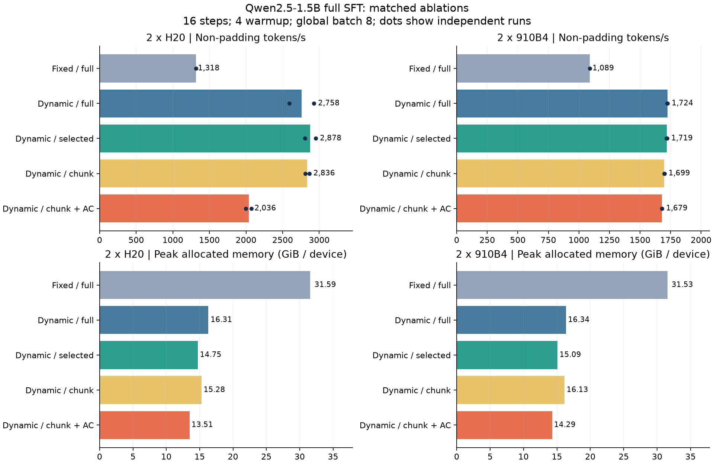
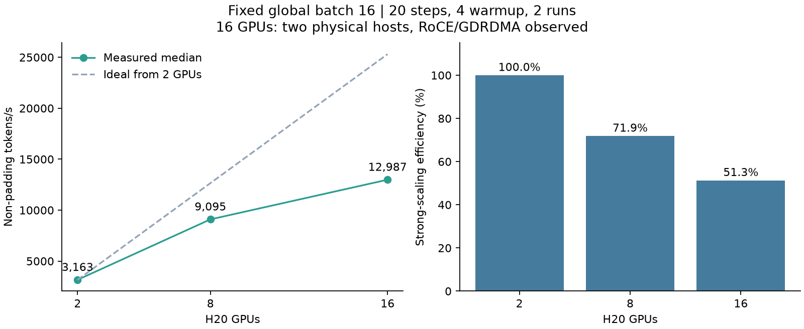

# H20 / 910B4 全参数 SFT 实验报告

实验日期：2026-10-19。模型：Qwen2.5-1.5B-Instruct；任务：公开对话数据上的全参数 SFT。

本项目已经完成双后端训练、保持目标一致的显存优化、梯度同步消融、H20 两机 16 卡强扩展及恢复验证。
适合把它作为训练 Infra 项目的基础：重点是训练正确性、通信与显存取舍、可追溯测量，
实际规模是 **1.54B 参数、最多两机 16 卡**。它不是千卡系统或大模型收敛实验。

## 1. 实验对象与复现条件

| 项目 | 实际设置 |
|---|---|
| 参数量 | 1,543,714,304；全部可训练，无 LoRA |
| 模型结构 | Qwen2 decoder；28 层，hidden size 1536，词表 151936，输入输出 embedding 共享 |
| 数据 | HuggingFaceH4/no_robots，准备了 2048 条 train / 128 条 test |
| 主消融 | 每变体 16 步；global batch 8；microbatch 1；前 4 步不计时 |
| 强扩展 | 每变体 20 步；global batch 16；microbatch 1；前 4 步不计时 |
| 精度 | FP32 参数与 Adam 状态，BF16 前向，FP32 梯度归约 |
| 优化器 | AdamW，lr=1e-5，weight decay=0.01，betas=(0.9,0.999)，eps=1e-8；全局梯度裁剪 1.0 |
| H20 | PyTorch 2.9.1，Transformers 4.57.1，CUDA/NCCL；主消融 HL，扩展实验 LF |
| 910B4 | PyTorch 2.7.1+cpu + torch-npu 2.7.1，Transformers 4.57.1，CANN/HCCL，HL |
| Attention | Transformers SDPA；H20 profiler 中确认 cuDNN attention kernel |

模型、原始 parquet、分词产物均按文件校验 SHA256；两种硬件使用相同 manifest，
摘要为 `7b090baee1f35c36a7486e0f126e40c5be2d4834157506e2c6cb8016a12b5a12`。
具体 revision、license 和文件摘要见 [assets_manifest.json](results/assets_manifest.json)。
数据集许可为 CC-BY-NC-4.0。

主消融每次只使用固定顺序的前 128 条样本；强扩展使用前 320 条。
没有把全部 2048 条训练一遍，也没有把下载的完整 9500 条训练集写成实际训练量。
每个变体重新加载相同初始权重，避免前一组更新污染后一组。

## 2. 先证明训练目标没有改错

损失只监督 assistant 内容；因果移位保持 `hidden[t] -> label[t+1]`。
完整模板分词后的字符 offset 用于标记监督区间，跨边界 token 保守忽略。
每次 backward 使用：

```text
本 microbatch 的 token loss 总和 × world_size / 本 optimizer step 的全局监督 token 数
```

FSDP 默认对 rank 梯度取平均，乘 world_size 抵消这一步。
这保证不同 rank / microbatch 的回答长度不等时，仍对应全局 token mean。

验证覆盖三层：

1. CPU / H20 / NPU 小模型：全量 logits 与监督位置分块的 loss、每个参数梯度，
   全忽略标签返回零梯度，共享 embedding，非等长 mask。
2. 小型真实 Qwen 结构对照 Hugging Face loss：固定/动态 padding、筛选/分块、
   Transformer activation checkpoint 的 loss 和逐参数梯度。
3. 多卡 FSDP2：和未分片参考模型比较梯度及一次 SGD 更新；追加了延迟同步路径。

浮点校验使用显式容差；例如小模型 BF16 梯度相对 L2 误差要求 <2%。
不能把“小模型逐参数校验”表述成“1.5B 全量模型所有优化路径逐位相等”。
真正 1.5B 的逐字节状态比较在后面的确定性恢复实验中单独进行。

每个任务的校验输出、实际环境、参数量与源码摘要保存在各结果目录的
`validation_events.json`、`job_evidence.json`、`source_manifest.json`。

## 3. 双卡显存与吞吐消融

下表吞吐单位为 **全体设备的非 padding token/s**，使用各组中位数；括号为两次原始值。
显存为所有 rank 中最大的 peak allocated GiB。固定 padding 两组只有一次测量。

| 配置 | 2×H20 吞吐 | H20 GiB/卡 | 2×910B4 吞吐 | 910B4 GiB/卡 |
|---|---:|---:|---:|---:|
| 固定 4096，full | 1318 | 31.59 | 1089 | 31.53 |
| 固定 4096，chunk | 1439 | 25.93 | 1188 | 26.75 |
| 动态，full | 2758 (2592 / 2925) | 16.31 | 1724 (1723 / 1725) | 16.34 |
| 动态，selected | 2878 (2950 / 2805) | 14.75 | 1719 (1721 / 1716) | 15.09 |
| 动态，chunk | 2836 (2864 / 2809) | 15.28 | 1699 (1698 / 1699) | 16.13 |
| 动态，chunk + Transformer AC | 2036 (2074 / 1997) | 13.51 | 1679 (1679 / 1678) | 14.29 |



`full` 对所有输入位置计算词表投影；`selected` 仅对有监督 label 的位置投影；
`chunk` 在监督位置上每 256 token 分块，并在 backward 重算各块，限制临时 logits。
Transformer AC 是另一个独立开关，不应与 loss 分块重计算混为一谈。

**最大的收益来自消除多余 padding。** 测量步中，固定 4096 的 padding 比例是 92.1%，
动态对齐 128 后是 16.2%。本批样本平均长度约 305，最长约 1469，因此固定 4096 是
故意保留的较弱基线。H20 动态 full 的中位吞吐约为固定 full 的 2.09 倍，
NPU 约为 1.58 倍；这些收益不能宣称为相对成熟 packing 实现的提升。

相同动态 padding 下，selected 在 H20 上把显存从 16.31 降至 14.75 GiB，
NPU 从 16.34 降至 15.09 GiB。吞吐变化较小，尤其 H20 两次 full 测量波动明显，
样本不足以证明小幅速度优势具有统计显著性。

**分块方案在短样本上没有胜出。** 它在固定 padding 场景减少显存，但动态场景的
峰值与吞吐均未稳定优于 selected。分块引入重计算及额外生命周期；实际峰值还受
FSDP 参数聚合和 allocator 影响，不能只用 logits 理论尺寸预测整个进程的峰值。

Transformer AC 相对动态 chunk：H20 显存约降 11.6%，吞吐约降 28.2%；
NPU 显存约降 11.5%，吞吐约降 1.2%。这支持在本 NPU 软件栈和负载下优先评估
AC 的性价比；并不构成所有 NPU 工作负载都“重计算免费”的证据。

## 4. 从 profiler 到梯度同步消融

H20 原始 profiler 的 chunk 变体中，一个 optimizer step 的 rank 0 有：

- 116 次 ReduceScatter kernel，持续时间相加约 100.6 ms；
- 232 次 AllGather kernel，持续时间相加约 87.0 ms。

模型有 28 个 layer FSDP 单元和 1 个 root 单元；双卡、global batch 8 对应每卡
4 个 microbatch。`29 × 4 = 116`，为减少同步频次提供了直接证据。

实现增加 `--defer-gradient-sync`：前三次 microbatch 的梯度留在完整参数形状，
最后一次才 reduce-scatter。参数前向/反向的 all-gather 仍保留。
它改变通信时机，也会增加未分片梯度的驻留内存。

H20 采用同一 LF 节点、相同 selected loss / dynamic padding，按“原同步 →
延迟 → 延迟 → 原同步”顺序独立加载训练，每个配置两次、16 步、预热 4 步。

| 后端/同步方式 | 两次原始 token/s | 中位 token/s | 峰值 GiB/卡 |
|---|---:|---:|---:|
| H20，每次同步 | 2594 / 3166 | 2880 | 14.75 |
| H20，最后一次同步 | 3321 / 3191 | 3256 | 17.63 |
| 910B4，每次同步 | 1730 / 1724 | 1727 | 15.09 |
| 910B4，最后一次同步 | 2474 / 2478 | 2476 | 17.97 |

H20 中位吞吐提升 **13.1%**，峰值显存增加 **2.88 GiB/卡（19.5%）**。
原同步两次结果相差约 22%，样本很少，应将速度收益视为短程观测，不宣称稳定提升 13%。
更确定的结果是 profiler 在相同 step 的 ReduceScatter **116→29 次（减少 75%）**，
AllGather 保持 232 次。实现保持全局 token 归一化；浮点归约顺序改变，因此普通
BF16 训练不要求切换同步模式后逐位相同。

910B4 使用同一 HL 节点、相同实验顺序与预算，延迟同步中位吞吐提升 **43.4%**，
峰值显存增加 **2.88 GiB/卡（19.1%）**。两次重复很接近，但仍只是本模型/软件栈的
短程结果。NPU 未采集对应 profiler，因此这里对通信次数的实测结论仅限 H20。
这使“梯度累积同步频率与显存预算”的取舍成为本项目最有依据的 NPU 优化切入点。

Profiler 的 CPU/设备事件、通信 annotation 与 kernel 可以互相包含，
不同 stream 也可能重叠。这里仅按真实 kernel 分类计数；持续时间的和不是
训练 step 的独占耗时，不能把表中的百分比相加声称“通信占比”。
原始 trace、operator 表和机器可读汇总保存在 `results/`。

## 5. H20 两机 16 卡强扩展

三组均在 LF，固定 global batch 16、20 步、同一数据顺序、dynamic + chunk、
无 Transformer AC；每组两次。测量区间 step 4–19，共 16 步。

| H20 数量 | 原始两次 token/s | 中位数 | 相对 2 卡加速 | 强扩展效率 | 峰值 GiB/卡 |
|---|---:|---:|---:|---:|---:|
| 2 | 3149 / 3178 | 3163 | 1.00× | 100% | 19.88 |
| 8 | 9074 / 9116 | 9095 | 2.87× | 71.9% | 11.25 |
| 16（2×8） | 12911 / 13063 | 12987 | 4.11× | 51.3% | 9.42 |



效率定义：`(T_N / T_2) / (N / 2)`。8→16 卡自身的增速约 1.43 倍。
模型较小、序列较短，每卡工作量随扩卡下降，16 卡没有线性扩展。
不能仅凭该表把差距全部归因于网络；未单独分离 host launch、计算不均与通信等待。

实际两个 pod 的 `host` 不同，应用内 16 rank 收集出的两个 hostname 也不同。
NCCL 日志既有 `mlx5_1..4 / RoCE`，也有跨 rank 的
`via NET/soft_bonding_v8/.../GDRDMA`，证据见
[网络日志节选](results/h20-scale16-v2/network_evidence.txt) 和
[任务/pod 记录](results/h20-scale16-v2/job_evidence.json)。
两个 pod 均 exit 0，均出现 `LAB_SUITE_COMPLETE` 和产物归档成功。

每卡累积次数随规模从 8→2→1 变化，这是固定 batch 强扩展的一部分。
本组 global batch、样本区间和主消融不同，不能把它的双卡吞吐直接拿来
计算主消融优化收益。验证集 loss 约由 2.078 降到 2.008–2.010，
仅用于观察短程训练行为，不证明收敛或泛化质量。

## 6. 断点恢复与真实失败修复

DCP 保存模型/Adam 状态，额外保存每 rank 的 CPU/设备 RNG、下一个 step、
world size 和训练配置/数据摘要。数据顺序由 step 确定，恢复时校验这些字段。

比较：同初始权重连续训练 6 步，与独立进程训练 3 步、保存、再启动新进程续跑 3 步。
分别检查“保存状态 vs 加载后初始状态”和“连续最终状态 vs 续跑最终状态”。
哈希覆盖每个 rank 的所有持久参数分片、Adam tensor 状态及 step；同时比较最终 eval。

| 环境 | 加载后参数/Adam 字节一致 | 续跑最终状态字节一致 | 最终 eval loss |
|---|---|---|---:|
| 2×H20，确定性模式 | 通过 | 通过 | 2.06273389 |
| 2×910B4，确定性模式 | 通过 | 通过 | 2.06298852 |

两种硬件各自与本硬件的连续运行比较，不要求 H20 与 NPU 跨硬件逐位相同。
原始门禁文件：[H20](results/h20-recovery-v2/results/recovery_gate.json)、
[910B4](results/npu-recovery-v3/results/recovery_gate.json)。

实验过程中保留了两次有价值的失败：

- H20 初版未启用确定性算子时，连续与分段运行在保存前的 step 1 已出现 loss 差异。
  因而不能把最终哈希不同直接归因于 DCP。启用确定性算法、cuDNN deterministic 与
  CUBLAS 工作区设置后，同环境重放通过。性能实验没有开启这一选项。
  [保存前的逐步比较](results/h20-recovery-lf-v1/pre_checkpoint_comparison.json)和
  [失败断言](results/h20-recovery-lf-v1/failure_excerpt.txt)保留在归档中。
- NPU 旧版摘要检查经 `model.named_parameters()` 获取 FSDP 临时视图，再用
  `optimizer.state[param]` 读取 defaultdict，会插入不属于 optimizer param group 的条目。
  保存时在 Adam state_dict 的 `param_mappings[id(k)]` 触发 KeyError，pod exit 1。
  修复为遍历优化器持有的持久参数，使用 `.get()` 只读访问；增加孤立状态断言与
  `verify_fingerprint.py` 回归检查，避免诊断行为改变被测状态。
  修复后 NPU 运行日志确认 338 个持久参数、2 个临时视图、0 个孤立状态；
  [旧版错误栈](results/npu-recovery-v2/failure_excerpt.txt)保留了保存时的原始 KeyError。

恢复范围限定为相同设备类型与软件环境、相同 world size、完整 optimizer step 边界。
本次是同任务内新进程加载本地 DCP，然后归档到 HDFS；未模拟整机突然断电、
跨机器重新调度、HDFS 部分写入或中途改变卡数。RNG 已保存/加载，但 Qwen 当前
配置无 dropout，实验未独立施加强随机性压力。最终 checkpoint 另归档在
个人 HDFS 的 `training_infra_lab/20261019/runs/<recovery-tag>/checkpoint/`。

## 7. 测量边界与后续价值

吞吐计时包括 forward、loss、backward、全局梯度裁剪、AdamW；设备同步后取最慢 rank。
数据 batch 搬运、有效 token 统计、barrier、模型加载、分词、eval、checkpoint 均不在
计时内。故这些数字是驻留 batch 的训练步吞吐，不是完整数据流水线吞吐。
显存峰值在预热结束时重置，取全 rank 最大 allocated；reserved 另在 result.json 报告。
Profiler 的 step 不参与普通吞吐汇总。
例如 16 卡实验两个 pod 分别运行了约 3 分 42 秒和 4 分 11 秒，包含初始化、
正确性检查、资产复制、重复加载和归档；表中的吞吐仅来自指定的训练测量步。
它不能直接换算为整个任务的有效 GPU-hour 成本或 MFU。

每项动态变体仅两次短测，没有统计显著性、长期稳定性或完整模型质量验收。
两种硬件的软件版本和 kernel 不同，绝对速度不能外推成硬件总体排名。
当前模型初始化会先在每个设备物化完整模型，尚未实现 meta 初始化/分片直接加载，
扩大到 8B/14B 前应先处理这一初始化峰值。

最有价值的继续方向是：

1. **H20：变长负载均衡与 FSDP 通信调度。** 保持全局样本集合及 token 归一化不变，
   将不同长度样本按每步计算量分配给 rank，测最慢 rank 等待和 scaling efficiency。
2. **910B4：内存预算下的真实中长序列训练。** 扩大有效长度，比较 AC、同步时机、
   loss 实现，采集 NPU profiler，明确 host 调度/算子/通信瓶颈后再写 fused kernel。
3. **扩大模型与可靠性验证。** 先完成分片加载再尝试 8B；注入进程失败，验证从持久存储
   恢复参数、Adam、RNG 和数据位置，记录恢复时间和重复计算量。

这些是下一阶段方向，不能算成本次已经实现。当前没有做 packing、长度均衡调度、
自定义 CUDA/AscendC 算子、异构混合训练、低带宽同步或弹性恢复。

## 8. 结果与源码索引

- [代码入口与复现](README.md)；[逐步源码学习指南](source-guide.md)。
- [原始训练结果索引](results/all_results.json)：每步 loss、token 数、时间和显存；含恢复片段及失败任务的已完成片段，不能直接混合平均。
- [严格按任务/配置/测量步分组的摘要](results/summary.json)。
- [图表数据与 profiler 统计](results/report_metrics.json)。
- [结果一致性审计](results/evidence_audit.json)：重新计算吞吐，检查同组 token 预算、
  全参数计数、输入与源码摘要、恢复状态、双宿主机和任务终态。
- 每个实验目录含 `job_evidence.json`、`validation_events.json`、`bundle.tar.gz`；
  bundle 是该任务实际执行时的源码快照，避免后续修改破坏复现。

| 实验 | Job | Trial | 状态 |
|---|---|---|---|
| h20-benchmark-v1 | [06b827da05c0de7a](https://ml.bytedance.net/development/instance/jobs/06b827da05c0de7a) | 434441425 | 完成，exit 0 |
| npu-benchmark-v1 | [af91546213309bb4](https://ml.bytedance.net/development/instance/jobs/af91546213309bb4) | 434441468 | 完成，exit 0 |
| h20-scale2-v1 | [010e97bd4e9acb40](https://ml.bytedance.net/development/instance/jobs/010e97bd4e9acb40) | 434443294 | 完成，exit 0 |
| h20-scale8-v1 | [6321c5636534f2fe](https://ml.bytedance.net/development/instance/jobs/6321c5636534f2fe) | 434443396 | 完成，exit 0 |
| h20-scale16-v2 | [3f14a514bef7f3d9](https://ml.bytedance.net/development/instance/jobs/3f14a514bef7f3d9) | 434449354 | 完成，exit 0 |
| h20-recovery-v2 | [c91d0bb9db483311](https://ml.bytedance.net/development/instance/jobs/c91d0bb9db483311) | 434452064 | 完成，exit 0 |
| npu-recovery-v3 | [f6e7bdc1448dcbb0](https://ml.bytedance.net/development/instance/jobs/f6e7bdc1448dcbb0) | 434470499 | 完成，exit 0 |
| h20-sync-v1 | [c266005e99786b34](https://ml.bytedance.net/development/instance/jobs/c266005e99786b34) | 434470556 | 完成，exit 0 |
| npu-sync-v1 | [194aff8c09b34bc8](https://ml.bytedance.net/development/instance/jobs/194aff8c09b34bc8) | 434470612 | 完成，exit 0 |

复现任务经唯一业务 payload 预检；`error` 会阻止提交，`warn/hint` 展示后处理。
预检 SID 保留式合并到 `request_context.precheck_sid`，并在 30 分钟内提交。
本报告使用的后续训练任务预检全部通过。日志来自 cn 控制面的 log-proxy；
分享目录只保留选定证据，未包含完整平台环境或签名日志下载链接。

## 9. 简历表述与参考

可在理解并能复现后使用如下表述：

> 实现基于 PyTorch FSDP2 的 Qwen2.5-1.5B 全参数 SFT 实验系统，适配
> H20/CUDA 与 Ascend 910B4/HCCL；完成不等长监督 token 的分布式梯度一致性、
> 输出层显存与重计算消融，以及参数/Adam 状态逐字节一致的断点重放验证。
> 在两机 16×H20 上完成固定 global batch 强扩展，实测约 1.30 万有效 token/s、
> 相对 2 卡加速 4.11×；通过梯度累积延迟同步，将每步 ReduceScatter 次数由
> 116 降至 29；同条件双卡 910B4 短测中，吞吐由约 1727 提升至 2476 token/s
> （+43.4%），额外显存约 2.88 GiB/卡。

避免写成“训练出更强模型”“自研新型分布式算法”“生产级弹性系统”或“千卡优化”。
当前证据支持的是完整参数训练的工程实验、精确恢复校验及两机扩展测量。

应当能现场解释：token mean 如何跨 rank 正确归一化；为何输出层分块还需要重计算；
为什么 FSDP2 的共享 embedding 要归同一 owner；为何延迟同步占用更多显存；
为什么保存成功不等于重放一致；16 卡的效率如何定义。

参考：[FSDP2 教程](https://docs.pytorch.org/tutorials/intermediate/FSDP_tutorial.html)、
[Distributed Checkpoint](https://docs.pytorch.org/docs/stable/distributed.checkpoint.html)、
[Cut Cross-Entropy](https://github.com/apple/ml-cross-entropy)、
[Qwen 模型](https://huggingface.co/Qwen/Qwen2.5-1.5B-Instruct)、
[no_robots 数据集](https://huggingface.co/datasets/HuggingFaceH4/no_robots)。
分块 CE 和 FSDP 梯度延迟同步均是已有方法，项目价值在于跨后端正确集成、证据驱动
的取舍与实测验证，不主张算法原创。
