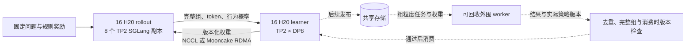

# 32 卡后训练项目：权重分发与可回收 rollout 扩展

2026-10-22。状态：源码调研与实验准备完成；未启动新的 GPU 任务，未取得新的训练或性能结果。该文将[方向调研](../../../posttraining-infra-directions-2026-10-21.md)收敛成首轮可执行范围。

## 1. 项目选择

项目定位为**基于 Miles 的分离式后训练运行时优化**。稳定 H20 域先完成 32 GPU 的真实 GRPO 闭环，围绕训练权重交给推理引擎时的停顿做一个可归因的改进；外围可回收资源作为第二阶段扩展。训练器、推理器和 RL 目标复用成熟框架。

首版明确承担三项工作：固定并验证多机运行栈；建立权重更新的阶段观测和同配置基线；针对实测瓶颈完成小范围源码修改与正确性验证。切换 `p2p`、开启 packed broadcast 或运行现成脚本，只计作部署和基线工作。

正式对照采用 **Miles / Megatron / SGLang，Qwen3-8B，16 learner + 16 rollout**。先用 Qwen3-4B 验证通信契约。选择它们的原因是与当前 P2P 文档和模型路径直接对应，便于先隔离系统变量；这不是对模型能力的排名。已有 Qwen3.5-9B 资产和数值检查可用于后续迁移，但不能把既有原生 FSDP 结果当成 Miles/Megatron 验收。<a href="#s1">[1]</a><a href="#s2">[2]</a>

候选资源布局：



图中外围路径是后续设计，没有实现或验收。32 张是整个后训练流水线的 GPU 数，实际执行参数更新的是 16 张。训练域的梯度通信与训推间的权重通信分别观测，不能混为一个“RDMA 加速比”。

## 2. 源码核对改变了哪些判断

本轮直接下载 Miles `2233d795dcf167be489d1859971c9233393f04c3`。归档来源与 SHA256 在 [miles-source.json](upstream/miles-source.json)，关键文件 SHA256、符号和行号在 [source-audit.json](source-audit.json)。`upstream/miles/` 是只供阅读的选定类型文件快照，不是完整可运行环境。

下表均为**该版本单一上游源码的事实**；测试文件存在不等于本轮运行通过。官网正文与代码冲突时，实验按固定代码处理，不继续沿用过时描述。

| 原文档或直觉 | 固定源码的实际情况 | 项目决策 |
|---|---|---|
| disk-delta 仅 Megatron | 共享 `WeightUpdater` + 协议工厂已覆盖其他后端；存在 FSDP 0.6B、TorchTitan Qwen3.5-4B E2E 文件 | 不把“接入 FSDP disk-delta”当成空白 |
| 只有逐 tensor NCCL 与 P2P | 另有 `broadcast_packed`，一 bucket 一次 broadcast，支持混合 dtype 的对应 SGLang 实现 | packed NCCL 必须进入同后端强基线 |
| P2P 就是源端 GPU 零拷贝 | `MooncakeTransport.transfer_buffer_device = cpu`，分配 pinned host buffer | 实测 D2H、目标布局加载、注册内存和传输；不宣称 GPU→GPU 零拷贝 |
| 可以新增双缓冲和缓存映射 | P2P 已有双 buffer、cached replica、跨重连的映射/连接复用 | 不重复实现已有机制 |
| 首次 disk-delta 只取基线 | `begin_sync` 先捕获基线，随后同次 sync 继续编码、发布和 reload | 初始化与稳态更新分开统计，不能默认第一轮无发布 |
| fully async 在每次更新前都等下一次 generate 完成 | `train_async.py` 中等待逻辑受 `not args.fully_async` 限制；fully async producer 持续工作，消费时检查陈旧度 | 普通 async 与 fully async 分开分析 |
| 一个 version 字段足够 | 当前 buffer 统计组内 oldest/newest/token 版本，消费时再次检查；sample backfill 也已存在 | 复用版本语义和完整组背压 |
| 存储同步可以直接承担恢复 | 当前参数校验拒绝 disk-delta 从所识别的 Megatron training checkpoint 恢复；初始化会清理发布目录 | 每个实验独占发布目录；完整训练恢复需单独设计、验证 |

源码依据：共享驱动、协议、测试、异步 loop。<a href="#s1">[1]</a> 模型支持和环境限制依据固定文档。<a href="#s2">[2]</a><a href="#s3">[3]</a>

这几处差异也说明：只读框架介绍容易高估可用能力，或误把已经合并的功能当成项目创新。必须同时锁定 Miles、SGLang、Megatron、CUDA/kernel、模型和数据；只锁一个仓库不够。官方安装说明强调其依赖 patched SGLang/Megatron。H20 不在该页面列出的 CI 硬件表中，需要独立预验，不能把 H100/H200 CI 自动视为 H20 验证。<a href="#s3">[3]</a>

## 3. 首个代码贡献如何选择

首个确定的开发任务是**权重更新阶段观测与完整事件归档**。当前 `update_weights_implementation` 同时包含权重迭代、转换、发送、等待及 barrier；`finalize_and_resume_engines` 也包含多项操作，单看总时间无法定位应改的模块。<a href="#s1">[1]</a>

计划在下列边界添加可关闭的计时/trace 标记，并记录 `run_id, sync_id, policy_version, rank, receiver_id, protocol, bucket_bytes, status`：

| 阶段 | 插入边界 | 正确解释 |
|---|---|---|
| 提取权重 | iterator 的 next / gather completion | 主机等待包含通信与转换时，不称为纯网络时间 |
| 格式与分片转换 | HF iterator、ModelReplica loader | 区分首次映射和每轮加载；量化关闭，避免额外变量 |
| 发送与在途等待 | `send_bucket`、buffer acquire、tail drain | P2P 提交返回不等于 DMA 完成；用 completion 事件核对 |
| 存储路径 | snapshot、diff/compress、write、pull/materialize | 与 RDMA 分开分组比较，记录实际字节和 CPU 内存 |
| 引擎暂停与激活 | pause request/ack、begin/end、版本确认、resume | trainer RPC 墙钟只能作近似；真实不可服务区间需要 engine 侧事件 |
| 消费和恢复 | group 完成、入队、消费、重试、拒绝 | 接受样本数不等于非零学习信号 |

计时工具不应插入额外的全局 barrier 或每 bucket CUDA synchronize 改变原有重叠。主机单调时钟只在同进程比较；跨主机因果用 ID/ack 关联，不能直接相减未同步的时间戳。GPU kernel/通信耗时通过独立 profiler 补充，不与嵌套主机区间相加。插桩开关对照用于估计自身开销，正式吞吐运行关闭重型 profiler。

**具体优化候选：disk-delta 的 pinned staging pool 复用。** `_begin_encode` 每轮新建队列、pinned buffers 和线程池；P2P 的 buffers 则已经缓存。这是确认过的实现差别，但不是确认过的性能瓶颈。<a href="#s1">[1]</a>

仅当真实 trace 表明重复分配有可观开销，才实现按容量/dtype 生命周期缓存的 pool；约束为同等内存上限、在途任务完成后复用、异常排空、首次初始化与重启后状态正确。验收须比较输出 checkpoint checksum、缺失/损坏 delta 的拒绝、两次连续更新，以及完整端到端时间。线程池或 pinned buffer 的局部变快，不能直接称为 GRPO 加速。该候选属于共享存储扩展，不能把其收益记到 P2P 实验中。

如果主瓶颈在 P2P 的 CPU 目标布局装载或串行等待，则以真实 trace 再选一处改进；若普通/packed NCCL 已足够快，就保留它们。若权重同步占整体时间很少，不继续投入传输优化。即使完全消除一个耗时占比为 p 的串行阶段，理想总加速上界也只有 `1/(1-p)`；异步重叠时应看暴露时间，而非累加各阶段忙碌时间。

本轮没有修改上游生产逻辑，也未实现上述观测补丁或性能补丁。现在具备的是源码定位、候选假设和明确的验证入口。

## 4. 固定实验配置

机读方案：[experiment-plan.json](https://github.com/Cheongroach/training-infra-lab/blob/main/training_infra_lab/research/posttraining_20261022/experiment-plan.json)。它是实验规格，不是可以直接提交的作业请求；镜像 digest、依赖 commit、模型 revision、数据 hash 和队列仍需由运行前预验固定。

| 阶段 | 模型 | learner | rollout | 工作量与目标 |
|---|---|---|---|---|
| 功能预验 | Qwen3-4B | 2 GPU，TP2 | 2 GPU，2×TP1 | 3 次真实更新；先核对 token、概率、reward、权重版本 |
| 跨机预验 | Qwen3-8B | 1×8 GPU，TP2/DP4 | 另 1×8 GPU，4×TP2 | 10 次更新；权重流量确实跨机；采集 RDMA 证据 |
| 主实验 | Qwen3-8B | 2×8 GPU，TP2/DP8 | 另 2×8 GPU，8×TP2 | 候选 50 次更新，前 5 次 warmup；同工作量 A/B |

候选主负载：32 个 prompt group × 每组 8 个回答 = 256 条 trajectory / 全局 batch；response 上限 2048；temperature=1；每次更新同步权重；使用上游 `deepscaler` 数学奖励，首版不做动态 reward 过滤，不因零方差而补抽容易的题。KL coefficient 0、学习率 1e-6 是待验收配方参数，不能称为已验证的学习配置；最终要归档完整 resolved args、loss reduction、截断与 reward 规则。

2048 上限用于首轮系统对照。先观察实际终止原因与长度；如果大量回答仅因截断得到零奖励，调整两边共同的负载设置并重新建立基线，不能拿该结果证明数学能力提升。固定 held-out 评估题，记录训练数据与评估题的去重结果；小规模人工核对正常错答、格式失败、截断和正确答案。

TP2 限定在单节点内；跨节点主要是 learner 的 DP/分片通信和权重分发。实际 placement 必须检查，不从 flag 推断拓扑一定如此。FSDP 项目已有的 Adam epsilon 变更不能默默移入 Megatron；本项目保留并记录所选框架实际优化器设置。

## 5. 两晚如何使用

以下为工作排序，时间块是预算建议，不是对训练耗时的预测。假设每晚 8 小时，32 GPU × 16 小时 = 512 GPU-hours；提前的 4/16 卡准备和独立评估另计。尚未申请或消耗该预算。

| 窗口 | 任务 | 必须留下的结果 |
|---|---|---|
| 夜间前 | 小规模闭环、镜像/模型缓存、数值与奖励验证 | 固定依赖、checkpoint 转换、可复现命令、失败原因 |
| 第一晚前 2h | 16 卡跨机预验及 32 卡资源布局核对 | NCCL/Mooncake 日志、NIC 计数、拓扑、每 rank 状态 |
| 第一晚中 4h | 同一模型/数据/并行下比较 broadcast、packed、P2P | 初始化与稳态分开；实际同步字节、停顿、GRPO 吞吐 |
| 第一晚余 2h | 独立 profiler 和 checkpoint/概率检查 | 明确一个瓶颈或记录“不值得改”的结论 |
| 两晚之间 | 根据证据完成并本地验证一个小补丁 | 修改边界、正确性回归、异常路径说明 |
| 第二晚前 5h | 同条件 A/B，3 次独立成对运行 | 样本/更新工作量一致，顺序随机或交错；独立 seed 数据 |
| 第二晚余 3h | 固定评估、一次受控 worker 故障、整理证据 | 质量边界、恢复/重算成本、完整失败记录 |

若第二晚前补丁还未通过验证，窗口用于复现和排障，不把未完成结果塞进成功统计。50 次更新与三次重复是候选规模，需用第一轮实际耗时修订到卡时上限内；两晚不能承诺完成学习收敛或顶会证据。

测试顺序先控制规模：三个协议在相同初始 bucket 大小下比较，再只对有价值的两个协议扫描 64/256/1024 MiB，避免无必要地铺开完整笛卡尔积。buffer 大小相同也不代表实际内存相同：不可拆原子组可能超过目标大小，P2P 使用多个 buffer，需记录真正峰值。

RDMA 验收分两层：`NCCL_DEBUG=INFO` 等日志确认所选网络路径，并用真实训练/更新窗口的 HCA/RoCE 计数增量交叉核对；微基准只负责排除明显链路问题。`nccl-tests` 带宽高不能证明端到端训练已有效使用 RDMA。受控禁用 RDMA 必须为独立对照，不能拿它替代正常 RDMA 下的强基线。

## 6. 正确性与结果口径

必须保留完整 group、行为概率和 response mask，记录生成开始/结束及实际 token 的版本信息。第一版用同步执行隔离传输差异；后续 fully async 必须单独定义 staleness、off-policy correction 和 partial rollout 语义，不能只开开关。

权重验证先复用 `--check-weight-update-equal`，然后用固定输入比较同一目标版本的 logits/logprob。train/inference kernels 不同不必逐 bit 一致，但容差须预设，并保存全量结果。失败时不发布成功版本、不在成功吞吐统计中隐藏重试和重算。

三个主指标分别报告：

1. **同步路径**：每版本总墙钟、初始化/稳态、实际字节、尾等待和内存；有重叠的分项不相加。
2. **服务与训练**：引擎不可服务时间、真实生成 token/s、learner 等待占比、实际进入 loss 的完整组和有效 token/s。
3. **学习与成本**：固定评估准确率/长度/截断，非零 advantage 组比例，完整预留 GPU-hours；既看相同样本预算，也看相同墙钟。

固定轨迹回放可以验证一次更新和恢复，但不能代替在线 RL。不同独立任务的 reward 波动不能用单个种子掩盖。没有达到目标质量时，不报告 time-to-quality。

## 7. 外围资源与论文方向

外围资源只作为独立推理/打分/评估 worker 接入。共享存储负责版本、任务包和结果包；单协调器负责租约、attempt、去重与消费。首次不把不互联的设备加入 learner NCCL group，也不把 endpoint 发现当成网络打通。

优先按 worker 的实测准备时间与存活窗口决定是否接入，然后在固定 prompt 流中分配完整 group。生成结果携带实际策略版本、token IDs、behavior logprobs、采样配置、奖励版本。调度器在消费时重新检查，不把本地 accepted 标志当成已经训练。只挑最快完成的回答会改变组分布，故需要完整组等待/重试规则和按难度、长度的偏差审计。

待研究的问题是：**共享存储被新 worker 的版本追赶占满时，怎样控制接入和追赶，让新增资源增加最终消费的有效样本，而不是拖慢整个系统？** 这比“实现弹性 RL”具体，但仍需与 RLBoost、ECHO-2、Stitch、StaleFlow 做逐机制对照；前一报告已列出这些近邻，不能把异步、弹性、增量传输本身当作创新。

论文阶段需要真实的资源到达/回收轨迹、共享存储吞吐及拥塞测量，同一资源轨迹下的强基线、质量等价与多个负载。若收益只出现在人为极端限速，或只剩一个 HDFS 适配器，定位为工程贡献更合适。若准备成本长期高于可用窗口，外围卡转为固定模型 reward/eval 或离线偏好数据生成。

## 8. 源码阅读与可交付

按一条权重和一条 trajectory 的生命周期读代码，避免一次阅读整个框架：

| 顺序 | 固定源码入口 | 要能独立解释的问题 |
|---|---|---|
| 1 | [WeightUpdater.update_weights](upstream/miles/miles/backends/training_utils/weight_update/updater.py#L136-L185) | 谁暂停、谁发送、谁等完成、何时改版本？ |
| 2 | [broadcast / packed](upstream/miles/miles/backends/training_utils/weight_update/protocols/broadcast.py#L149-L211) | tensor 的名字、dtype、shape、字节对齐如何对应？ |
| 3 | [P2P](upstream/miles/miles/backends/training_utils/weight_update/protocols/p2p.py#L75-L172)、[buffers](upstream/miles/miles/backends/training_utils/weight_update/protocols/utils/transfer_buffers.py) | TP 布局怎么转换？异步传输结束前谁拥有内存？ |
| 4 | [disk-delta](upstream/miles/miles/backends/training_utils/weight_update/protocols/delta.py#L122-L403) | 为什么 XOR 要绑定 base？何时校验、materialize、激活？ |
| 5 | [异步训练主循环](upstream/miles/train_async.py#L79-L149) | 哪些步骤真正重叠？哪种模式还需要 drain？ |
| 6 | [消费时版本检查](upstream/miles/miles/rollout/fully_async_data_buffer.py#L215-L258) | 组为什么生成时有效、消费时却过期？ |

对应学习验收：追踪一个参数的完整 byte/layout 变化；手算一个 8 回答组的 advantage；用 trace 指出一次真正的通信等待；解释一次 worker 退出后哪些计算被重做、哪些样本不能消费。

当前可交付是本方案、机读矩阵、固定源码证据，以及 [inspect_preparation.py](https://github.com/Cheongroach/training-infra-lab/blob/main/training_infra_lab/research/posttraining_20261022/inspect_preparation.py)。该脚本不导入 Miles、不联网、不启动作业，只检查关键源码、CLI 注册名称、group/global-batch 关系、TP/DP 整除、rollout 副本数和卡时算术：

```bash
python3 training_infra_lab/research/posttraining_20261022/inspect_preparation.py
```

本轮该检查已退出 0：4 卡预验为 TP2/DP1 + 2 副本；16 卡为 TP2/DP4 + 4 副本；32 卡为 TP2/DP8 + 8 副本。结果不证明显存足够、模型数值正确、CLI 组合可运行或 RDMA 可用。尚未完成的是匹配镜像/资产预验、阶段观测补丁、真实 GPU 基线和优化。

最终简历所需的证据应为：实际卡数与角色、本人修改的路径、强基线瓶颈、正确性与故障检查、端到端结果及不适用区间。现阶段可以写“完成方案和源码分析”，不能填写训练性能提升数字。

## 9. 来源

<a id="s1"></a>**[1] Miles 固定源代码**，本轮通过 GitHub API 取得 commit，codeload 下载后实际读取；关键函数行号见本地 source-audit。
https://github.com/radixark/miles/tree/2233d795dcf167be489d1859971c9233393f04c3

<a id="s2"></a>**[2] Miles P2P Weight Transfer**，同一固定版本的模型表和实现描述；为上游验证范围，不是本地 H20 结果。
https://github.com/radixark/miles/blob/2233d795dcf167be489d1859971c9233393f04c3/docs/advanced/p2p-weight-transfer.md

<a id="s3"></a>**[3] Miles Installation**，同一固定版本的依赖与硬件说明。
https://github.com/radixark/miles/blob/2233d795dcf167be489d1859971c9233393f04c3/docs/getting-started/installation.md

上述三项同属一个上游项目，不构成三个独立性能证据。论文与跨框架方向依据前一调研的原始来源；本轮补充的是具体代码事实和实验设计。
